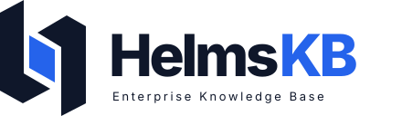

<p align="center">
  
</p>

# HelmsKB

HelmsKB 是面向企业私有化知识应用、基于 [Tencent/WeKnora](https://github.com/Tencent/WeKnora) 持续研发的平台。当前代码以 **WeKnora v0.8.3** 为完整技术基线，已迁入 HelmsKB 品牌界面和可复现的前端打包方式。

本仓库保留上游版权、许可证及第三方声明。HelmsKB 是独立维护的衍生项目，不是腾讯官方发行版；当前阶段不将上游全部代码描述为原创研发。

## 当前状态

| 范围 | 状态 |
| --- | --- |
| 完整源码基线 | v0.8.3，原始提交 `3e22822c1d2397be730c458c7539d0eb8c113a24`；4,950 个文件逐一验证，导入树与上游一致 |
| 品牌定制 | 登录、注册、导航、六种语言文案、透明几何标志、favicon 和示例文本 |
| 品牌配色 | Helms 与副标题 `#0F172A`；KB 与图形内侧 `#2563EB`；背景透明 |
| 开发基础 | 锁文件、前端构建、i18n 检查、只读权限的前端 CI |
| 独立环境 | 本仓库尚未部署 local/test/production；不沿用其他项目的端口、数据库、模型凭据或备份 |
| 业务验收 | 模型接入、真实资料入库、检索、引用、权限及容灾仍需逐项验证 |

上游基线包含文档解析、FAQ、混合检索、RAG 问答、Agent/MCP/Skills、Wiki、连接器、工作空间权限与调用追踪等能力。功能存在不等于已在特定企业资料上达到质量或容量目标。

## 开始开发

前端使用 Node.js 24 与 npm 锁文件：

```bash
cd frontend
npm ci --no-audit --no-fund
npm run check-i18n
npm run build
```

大型前端构建可设置 `NODE_OPTIONS=--max-old-space-size=3072`。后端 Go 版本以 `go.mod` 为准，DocReader 的 Python 依赖以其项目文件和锁文件为准。

独立启动前，先规划本项目的模型、解析器、数据库、存储和端口；不要直接复用其他项目的运行配置。详见 [开发说明](DEVELOPMENT.md)。

## 后续研发重点

- 行业资料治理：来源、有效版本、适用范围、审核发布与撤回。
- 可信回答：持久化评测、引用正确性、无答案拒答与回归检查。
- 企业集成：身份与权限适配、资料增量同步、业务系统入口。
- 可交付运维：独立部署、离线依赖、依赖就绪探针、备份恢复、升级与成本记录。

这些是研发方向，不代表已经实现。

## 来源、升级与自动化

- [上游来源与导入记录](UPSTREAM.md)
- [开发、验证与环境隔离](DEVELOPMENT.md)
- [上游原始 README](docs/upstream/README.v0.8.3.md)
- [上游原始中文 README](docs/upstream/README_CN.v0.8.3.md)

原有上游 GitHub Actions 工作流已移到 `.github/upstream-workflows/`，避免首次推送触发上游镜像、PyPI 或 npm 发布。当前启用的工作流只安装前端依赖、检查翻译和构建，不发布产品、不调用模型服务。

## 许可证

上游自有代码按 [LICENSE](LICENSE) 中的 MIT 条款提供，第三方组件分别遵守自己的许可证。保留 [THIRD_PARTY_NOTICES.md](THIRD_PARTY_NOTICES.md) 和 `licenses/`；分发后端或桌面包时，还需按上游打包流程携带要求的对应源码材料。
